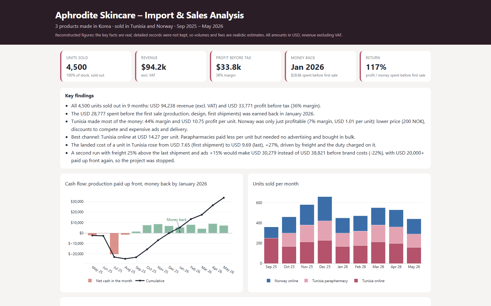

# Aphrodite Skincare – Import & Sales Analysis

I founded and ran **Aphrodite Skincare**, a small cosmetics brand. A
para-pharmacy adviser chose the ingredients, a manufacturer in **Korea** made
**3 products** under my own brand and packaging (1,500 units each,
**USD 20,000**), and I imported **3,000 units to Tunisia** and **1,500 to
Norway**. Everything sold out between September 2025 and May 2026.

Tunisia worked well: the products sold as a premium brand at **110 TND**, online
and in bulk to parapharmacies. Norway was harder: at **200 NOK** the competition
was stronger and advertising more expensive. When import and transport fees kept
rising, the profit of another production run no longer justified the money
paid up front, so I stopped the project.

This project turns that story into numbers: where the money came from, where
it went, and why stopping was the right decision.



> **About the data.** The facts above are real. The detailed sales records were
> not kept, so the order-level data is **reconstructed**: realistic estimates for
> volumes, discounts, shipping fees, customs, delivery and advertising, built to
> match the facts. Every estimate is listed in `ASSUMPTIONS` at the top of
> [make_data.py](make_data.py) and can be changed.

## Key findings

- All **4,500 units** sold out in 9 months: **USD 94,238** revenue (excl. VAT)
  and **USD 33,771** profit before tax (**36% margin**).
- The USD 28,777 spent before the first sale was **earned back in January 2026**.
- **Tunisia** made most of the money: **44% margin**, USD 10.75 profit per unit.
  **Norway** was only just profitable: **7% margin**, about USD 1 per unit.
- **Best channel:** Tunisia online, USD 14.27 per unit. Parapharmacies paid less
  per unit but needed no advertising and ordered in bulk.
- The **landed cost** of a unit in Tunisia rose from USD 7.65 to USD 9.69
  (**+27%**) between the first and last shipment: freight, plus the customs duty
  charged on it.
- A **second production run** at higher fees would earn about **22% less**, with
  USD 20,000+ paid up front again.

## What the dashboard shows

[Open the interactive dashboard](docs/index.html) (download the file and open it
in a browser, or see the [full-page screenshot](docs/screenshots/full_page.png)).

| Section | Question it answers |
|---|---|
| KPI cards | How big was the business, and how quickly did the money come back? |
| Cash flow | How deep did the investment go, and when did it turn positive? |
| Units per month | Which market and channel sold, and when? |
| Unit economics (waterfalls) | From the selling price, what went to the product, freight, customs, delivery and ads? |
| Landed cost by shipment | How much did rising fees add to every unit? |
| Profit by shipment | How did the margin shrink over time? |
| Profit and loss by market | Tunisia vs Norway, line by line |
| Freight sensitivity | At what freight cost does each channel stop making money? |
| Next production run | Was a second run worth it? |

## Power BI version

`python build.py` also exports a **star schema** (fact and dimension tables) to
`powerbi/`. [docs/POWERBI.md](docs/POWERBI.md) explains how to load it in Power BI
Desktop, the relationships, the **DAX measures** and the report pages.

## Run it

```bash
git clone https://github.com/eskandersnoussi/skincare-import-analysis.git
cd skincare-import-analysis
python -m venv venv
venv\Scripts\activate          # macOS/Linux: source venv/bin/activate
pip install -r requirements.txt
python build.py                # dashboard -> docs/index.html, Power BI tables -> powerbi/
```

To change an assumption (for example freight per unit or the Norway price),
edit `ASSUMPTIONS` in `make_data.py`, then run `python make_data.py` and
`python build.py` again.

## How the numbers are calculated

- **Revenue** is always excluding VAT (19% in Tunisia, 25% in Norway).
- **Landed cost** per unit = product cost + freight + customs duty + clearance,
  calculated per shipment. Duty is charged on the value of the goods plus
  freight, so it rises when freight rises.
- Each sale is matched to the shipment it came from (**first in, first out**),
  so every unit carries the real cost of its own shipment.
- **Advertising** is charged to online sales; parapharmacies bought without ads.
- **Shared brand costs** (formulation advice, packaging design, samples, photos,
  website, bank fees) are split between the markets by units sold.
- Currencies are converted at fixed rates: 1 USD = 3.05 TND = 10.6 NOK.

## Project structure

```
├── make_data.py           # rebuilds the data from the facts + listed assumptions
├── build.py               # builds the dashboard and the Power BI tables
├── skincare/
│   ├── analysis.py        # landed cost, P&L, unit economics, cash flow, scenarios
│   ├── dashboard.py       # interactive Plotly dashboard (one HTML page)
│   └── powerbi.py         # star-schema export
├── data/                  # products, shipments, sales (order lines), costs
├── powerbi/               # tables for Power BI
├── docs/                  # dashboard, Power BI guide, screenshots
└── tests/                 # automated checks
```

## Tests

```bash
pytest
```

12 tests check that the data matches the facts (4,500 units, USD 20,000
production, 110 TND / 200 NOK prices, no unit sold before its shipment arrived)
and that the analysis adds up (all shipping costs allocated, P&L equals cash,
unit economics equal the P&L).

## Tech

Python · pandas · Plotly · Power BI (star schema + DAX)

## License

MIT – see [LICENSE](LICENSE).
